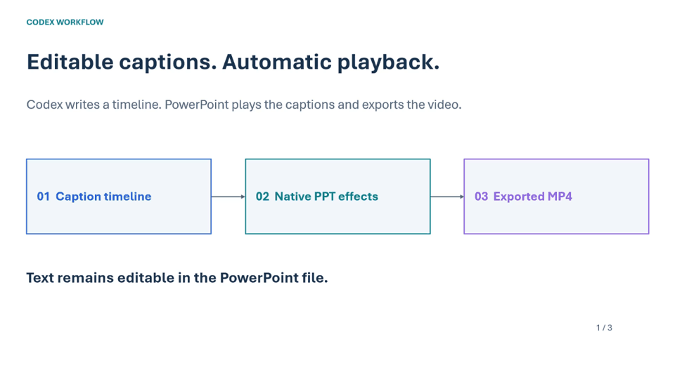

# codex-PPTtoVideo-skills

[English](README.md) | [简体中文](README.zh-CN.md)

**Turn an editable PowerPoint into an automatically playing captioned video with Codex.**

Codex prepares a subtitle timeline, adds native PowerPoint text boxes, applies Fade entrance and exit animations, sets automatic slide advance, and exports an MP4 through desktop Microsoft PowerPoint. The captions remain editable in the PPTX.

## Demo and downloads



*Above: an eight-second sampled preview of the exported video. Download the full 24-second video and source files below.*

- [Captioned demo PPTX](examples/subtitle-demo_captioned.pptx)
- [Actual exported MP4](examples/subtitle-demo_review.mp4)
- [Static PDF preview](examples/subtitle-demo_preview.pdf)
- [Caption timeline CSV](examples/subtitle_timeline_FINAL.csv)
- [Demo verification notes](examples/VERIFICATION.md)

The public example contains three generic slides, nine captions, and 24 seconds of playback. It does not include research data or laboratory photographs.

## Two synchronized animated diagrams

The upper half now contains two changing diagrams: an editable slide builds up on the left, while a video player and cue timeline advance on the right. Both change with the bottom caption. The demo groups each pair of diagram states with its editable caption and applies native Fade entrance/exit effects to that group. This explicit scene choreography is separate from the general caption-only helper. No screen recording or pre-rendered GIF is embedded in the PPTX.

## Requirements

- Windows with desktop Microsoft PowerPoint installed.
- PowerShell 7 (`pwsh`) for the bundled helpers.
- An active desktop login session for PowerPoint COM automation.
- An execution environment authorized to control PowerPoint and write the requested outputs.
- For Codex use: a local editable PPTX and caption text or permission to draft captions from the slides.

## Install the Codex Skill

Clone this repository and copy the `powerpoint-auto-subtitles` folder into your Codex skills directory. The usual Windows location is `%USERPROFILE%\.codex\skills`; use your configured `CODEX_HOME` if it differs.

```powershell
git clone https://github.com/machengjie321/codex-PPTtoVideo-skills.git
Copy-Item -LiteralPath ./codex-PPTtoVideo-skills/powerpoint-auto-subtitles `
  -Destination "$env:USERPROFILE/.codex/skills/powerpoint-auto-subtitles" -Recurse
```

Refresh the available skills or start a new Codex chat if the new skill is not listed. Avoid overwriting an existing installation with local edits.

## Complete workflow

**Prepare captions (choose: Agent drafts from PPTX / user supplies captions and Agent normalizes the format) → user reviews, edits and confirms → Agent prepares the caption area → user confirms the layout → confirmed PPTX and captions → estimated and checked timeline → native animation and automatic advance → MP4 export → playback QA and delivery.**

## Step 1: Prepare captions, then review and confirm

Choose one of two paths: have the Agent draft captions from the PPTX, or supply your own captions for format normalization. Both produce a standard `captions.md` for you to review, edit and confirm before video production.

### Path A: Agent drafts captions from the PPTX

Replace these example paths with real locations:

```text
Use $powerpoint-auto-subtitles to draft English captions automatically from my PPTX.
PPTX: C:/work/my-presentation.pptx
Caption output: C:/work/captions.md (UTF-8)
Review notes: C:/work/captions-review.md
Read each slide's visible text, figures and speaker notes, in actual slide order.
Write one idea per cue in presentation order. Preserve values, units and qualifications.
Do not invent unsupported claims or mechanically copy every chart label.
Use ## Slide N headings and one - bullet per complete English caption.
List ambiguous, unreadable or uncertain content in the separate review notes,
not in the visible captions. Do not fabricate captions for pages you cannot interpret.
For this stage, deliver only the draft and review notes. I will edit them manually
before asking you to create animations and export the video.
```

If you have speaker material, add “Reference script: C:/work/notes.docx”. Ask the Agent to flag conflicts with the deck in the review notes instead of choosing a value silently.

### Path B: Supply captions and let the Agent normalize the format

Provide your existing Word, TXT, Markdown or pasted captions together with the PPTX. The Agent organizes them without generating a replacement script.

```text
Use $powerpoint-auto-subtitles to format my supplied captions, not redraft them.
PPTX: C:/work/my-presentation.pptx
My captions: C:/work/my-subtitles.docx (or pasted text labeled by slide)
Normalized output: C:/work/captions.md (UTF-8; preserve the source file)
Review notes: C:/work/captions-review.md
Map captions to actual slide order using ## Slide N and one - bullet per cue.
Normalize formatting and check slide mapping only. Preserve my wording, order,
values and units. Do not translate, polish or add captions without my request.
If splitting a paragraph, retain the original text order. Suggest meaning-changing
edits only in the review notes rather than applying them.
Flag missing pages, ambiguous mappings and conflicts with the PPTX; do not guess.
Deliver the normalized captions and review notes. Wait for my manual review,
edits and confirmation before producing the video.
```

If you also want translation or polishing, specify the target language and permitted scope.

### Both paths: Review, edit and confirm the caption file


Use Notepad, VS Code or another text editor. Check slide correspondence, values and units; remove unwanted narration, add necessary explanations, polish the English and split long cues. Save as UTF-8 while retaining this structure:

```markdown
# Captions

## Slide 1
- This slide introduces the research platform.
- The diagram shows its main components.

## Slide 2
- This slide compares the two processing paths.
- The following animation explains the data flow.
```

- `## Slide N` is the actual one-based slide index, not its printed page label.
- Each `- ` line is one cue. Keep it on one physical line; multiple cues per slide are welcome.
- Only visible caption text belongs here; questions and suggestions belong in the review notes.
- Check all slides. The standard exporter requires at least one cue per slide; resolve incomplete or uncertain pages before export instead of using placeholders.
- No timestamps are needed yet. Timing will be estimated from the edited wording.

[Standard template](examples/captions.template.md) · [English example](examples/captions.en.md) · [Chinese format example](examples/captions.zh-CN.md) (format references, not forms you must fill from scratch).

### Return the confirmed captions to the Agent

After reviewing, editing and confirming, complete the layout review in Step 2, then use the Step 3 request below and name `C:/work/captions.md` as the final caption source. The Agent should retain your edited wording and recalculate timing, not replace your script with a fresh draft from the deck. Explicitly request a one-pass workflow if you want to skip manual review.

## Step 2: Have the Agent prepare a consistent caption area, then review it

Before adding captions, ask the Agent to standardize the bottom caption area across slides. Start with roughly **10%–15% of slide height**, then adjust to the actual font size, line count and content; this is not a fixed requirement. Leave separation from the body content and keep axes, figure captions, page numbers and logos unobstructed.

Preserve the existing visual style while aligning caption-area height, margins and text styling. Move or moderately resize body content when necessary. Do not hide content behind white rectangles or alter measured values. Reposition existing footers appropriately and flag crowded pages in the review notes.

Submit this layout request first:

```text
Use $powerpoint-auto-subtitles to prepare the slide layout and bottom caption area.
PPTX: C:/work/my-presentation.pptx
Final captions: C:/work/captions.md
Layout output directory: C:/work/layout-review
Reserve a consistent bottom caption safe area based on the actual captions.
Start around 10%–15% of slide height, adjust as needed, and separate it from body content.
Standardize placement, margins and suggested font size while retaining the visual style.
Reposition or resize body content as needed; preserve measured values, charts,
editable shapes and existing animations. Do not obscure or remove axes, figure captions,
page numbers or logos. Preserve the source file.
Deliver editable presentation-layout.pptx, PDF/per-slide previews and layout review notes.
Show each slide's longest caption in the review previews to check two-line text fit;
do not leave preview placeholders in the PPTX that will receive the real captions.
Do not add final caption animations or export video yet. Wait for my layout confirmation.
```

**User review:** Check every slide for clipping, overly reduced content, complete chart labels, consistent bottom spacing and readable longest captions. Ask the Agent to revise the previews if needed. After confirmation, use `C:/work/layout-review/presentation-layout.pptx` as the next input instead of the unformatted original.

## Step 3: Submit the complete production request

Replace the example paths with actual existing files and a new output folder. This example uses the caption document you manually edited in Step 1. An attachment can replace a path if identified by its exact filename. If using audio, give its path and request alignment to that recording.

```text
Use $powerpoint-auto-subtitles.
PPTX: C:/work/layout-review/presentation-layout.pptx (layout and caption area confirmed)
Caption source: C:/work/captions.md (my reviewed and confirmed final English captions)
Caption language: English. Preserve my edited wording; do not regenerate or overwrite the script.
Output directory: C:/work/captioned-output
Narration: none; create a silent captioned video.
Target total duration: 160 seconds.
Read the deck and final captions. Check slide-to-caption correspondence.
Calculate timings from the final text and save a copy in the output folder without overwriting the input.
Then continue to timeline generation, animation and video export; do not stop after formatting captions.
Estimate reading time from text length. If the captions cannot fit readably within
160 seconds, report the conflict rather than silently shortening text or speeding it up.
Apply native PowerPoint fades and automatic slide advance. Preserve all measured
values, charts and editable shapes. Do not overwrite the source.
Inspect the actual MP4 captions and duration. Deliver PPTX, MP4, PDF preview,
final timing CSV and a short QA report.
```

The example target of 160 seconds is configurable. The included public demo is 24 seconds.

Without a draft, replace the caption-source line with:

> Caption source: no existing script. Draft English captions only from this PPTX's text, figures and speaker notes, without inventing information.

Without a fixed duration requirement, replace the target with “Estimate from text length and report the final duration.”

### 3.1 The Agent generates and checks the timeline

After the complete request in Step 3, the Agent performs production and verification in sequence. You do not need to run individual commands.

The Agent reads your confirmed `captions.md` and creates `timeline-estimated.csv` with cue boundaries and slide durations. Defaults are 2.5 English words/s and 4 Chinese characters/s, plus reading pauses and fades. Rates are adjustable; actual narration takes priority over estimates.

The Agent checks total duration, long cues and text fit. A target such as 160 seconds must be compatible with readability, not achieved by truncating captions or forcing an unreadable pace. See [timing rules](powerpoint-auto-subtitles/references/caption-authoring.md) for the formula.

### 3.2 The Agent animates and exports

The Agent uses [add-subtitles-and-export.ps1](powerpoint-auto-subtitles/scripts/add-subtitles-and-export.ps1) to create editable caption boxes from the timeline, apply native **fade in → hold → fade out** effects, set automatic slide advance, and export MP4 and PDF through PowerPoint.

Preserve existing charts, values and editable shapes. Existing animations need deliberate timeline merging: the general helper does not merge them or rearrange charts automatically. Synchronized diagram changes require separate scene authoring against the same timeline.

### 3.3 The Agent verifies and delivers

The Agent decodes the actual MP4 and checks its duration, every caption, slide transitions and selected fade boundaries for residual text, overlaps and obstruction. Successful export is not playback verification, and the frame extractor does not judge visual quality automatically.

| Deliverable | Purpose |
|---|---|
| `captions.md` | User-confirmed caption script |
| `subtitle_timeline_FINAL.csv` | Final cue boundaries and slide durations |
| Captioned `.pptx` | Editable captions, native animation and automatic advance |
| `.mp4` | Actual automatically playing video |
| `.pdf` | Static preview with the first caption on each slide |
| QA notes | Actual duration, caption/diagram checks and limitations |

**The Codex-assisted workflow ends here. The appendix is an alternative for people who want to run the programs themselves, not another set of required steps.**

## Optional appendix: Run the scripts manually

This is the command-line alternative to the production workflow above. First confirm your captions and layout, and ensure the input PPTX below already has a reserved caption area. Open PowerShell at the repository root with `C:/work/my-presentation.pptx` and `C:/work/captions.md` ready. You need Python 3, PowerShell 7 and desktop PowerPoint on Windows. The output paths below must not already exist; choose fresh paths for another run.

### A. Caption document → timeline

```powershell
python ./powerpoint-auto-subtitles/scripts/captions-to-timeline.py C:/work/captions.md C:/work/timeline-estimated.csv
```

This reads the final captions and produces an estimated CSV. Default formula:

```text
cue duration = max(2.5, English words / 2.5 + Chinese characters / 4 + 0.4 + 0.25 + 0.25)
```

Cues have a 0.15-second gap; slides have a 0.5-second tail. Cues over 12 seconds trigger a splitting suggestion without truncation. To slow the pace, append `--english-wps 2.0 --chinese-cps 3.2 --pause 0.7` to the command.

Review the timeline before B. This script estimates from text length; **it does not automatically fit a 160-second target**. A fixed duration requires appropriate script/timeline adjustments and readability checks. See the [CSV contract](powerpoint-auto-subtitles/references/timeline.md).

### B. PPTX + timeline → native animation, MP4 and PDF

```powershell
pwsh -NoProfile -File ./powerpoint-auto-subtitles/scripts/add-subtitles-and-export.ps1 -InputPptx C:/work/my-presentation.pptx -TimelineCsv C:/work/timeline-estimated.csv -OutputDirectory C:/work/captioned-output
```

This uses the same CSV produced in A. It creates native Fade effects and automatic slide advance, then outputs `my-presentation_captioned.pptx`, `my-presentation_review.mp4`, `my-presentation_preview.pdf`, slide PNGs, `subtitle_timeline_FINAL.csv` and an automation report. The source deck is preserved.

The helper stops on existing animations or caption objects; merge those deliberately instead of clearing them. Video verification in the report remains pending at this point.

### C. Actual MP4 → inspection frames and QA notes

```powershell
pwsh -NoProfile -Sta -File ./powerpoint-auto-subtitles/scripts/extract-video-frames.ps1 -VideoPath C:/work/captioned-output/my-presentation_review.mp4 -TimelineCsv C:/work/captioned-output/subtitle_timeline_FINAL.csv -OutputDirectory C:/work/video-check
```

This uses the MP4 and final CSV from B. Inspect every extracted image, play the transition and fade intervals, and record actual duration and any issues in your QA notes. Successful extraction alone is not visual validation.

Further details: [animation timing formulas](powerpoint-auto-subtitles/references/timeline.md), [Office implementation and QA](powerpoint-auto-subtitles/references/office-workflow.md), and [Skill instructions](powerpoint-auto-subtitles/SKILL.md). Captions can overlap in editing view; native animation controls visibility during playback.
