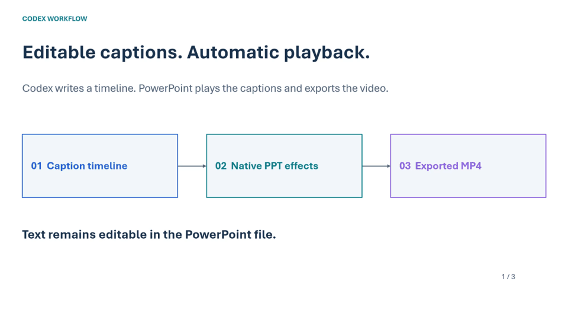
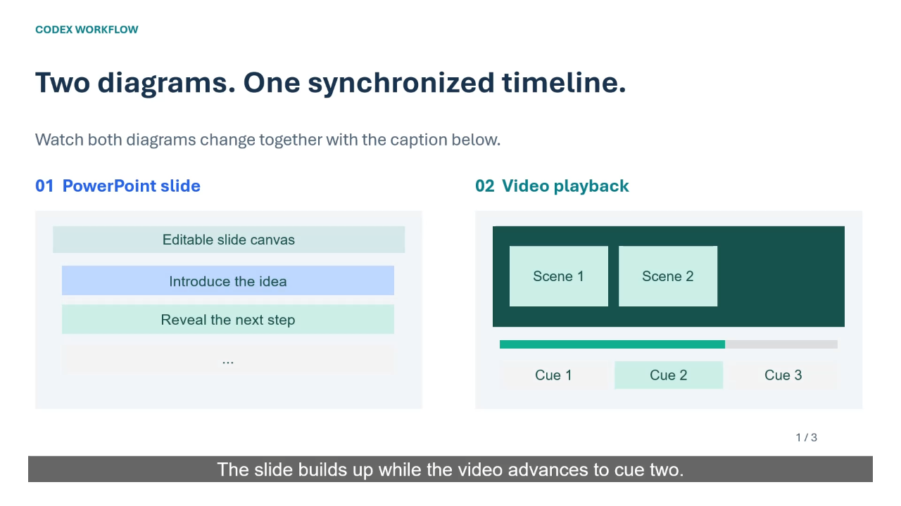

# 使用 Codex 自动给 PowerPoint 添加字幕并导出视频

[English](README.md) | [简体中文](README.zh-CN.md)

这个项目把“给 PPT 配字幕、设置自动播放、导出视频”的流程封装为一个 Codex Skill。

**字幕使用 PPT 内部原生文本框和动画实现，PPTX 中的文字可以继续编辑。** Codex 先编排时间表，再调用桌面版 PowerPoint 添加淡入淡出和自动翻页，最后由 PowerPoint 导出 MP4。



*动图取自 PowerPoint 实际导出的视频，用于快速展示字幕切换效果，经过缩短与抽帧，不作为精确时间依据。*

## 最终效果与可下载示例



- [可编辑字幕 PPTX](examples/subtitle-demo_captioned.pptx)
- [实际导出的视频 MP4](examples/subtitle-demo_review.mp4)
- [静态 PDF 预览](examples/subtitle-demo_preview.pdf)
- [字幕时间表 CSV](examples/subtitle_timeline_FINAL.csv)
- [示例验证记录](examples/VERIFICATION.md)

公开示例包含 3 页通用演示内容、9 条字幕，总时长 24 秒。示例未包含原始科研数据或实验室照片。

## 可以这样向别人介绍

> 我们把已有的 PowerPoint 交给 Codex，让它先根据每页内容生成字幕和时间表，再在 PPT 中创建可编辑的字幕文本框。每条字幕通过 PowerPoint 原生“淡入—停留—淡出”动画播放，页面按指定时间自动切换。最后使用 PowerPoint 自身的视频导出功能生成 MP4，并检查实际视频中的字幕切换和总时长。

英文简短介绍：

> We use Codex to turn an existing PowerPoint into a captioned video. It creates a subtitle timeline, adds editable text boxes with native fade animations, and sets automatic slide transitions. PowerPoint exports the timed presentation as an MP4. We then inspect the actual video to verify caption changes and total duration.

## 具体流程


### 1. 先准备内容和字幕区域

Codex 读取现有 PPT，保留图表、表格及可编辑图形，为字幕预留底部安全区域。有配音时，字幕要与实际语音对齐；没有配音时，可以根据幻灯片内容生成适合无声播放的说明字幕。

字幕时间表记录页索引、显示页码、每页时长、字幕名称、开始时间、结束时间和淡入淡出时长。注意，PPT 文件中的第 1 页可以显示为“08”，二者不是同一个概念。

### 2. 在 PPT 内部添加原生字幕动画

每条字幕都是独立文本框，动画顺序为：

**淡入 → 停留 → 淡出 → 下一条字幕**

脚本通过 PowerPoint 的 `TimeLine.MainSequence.AddEffect` 创建原生 Fade 动画。字幕可以在 PPT 中直接修改；单独生成 SRT 文件不能替代这个动画过程。

这里使用自动的 **After Previous（上一动画之后）** 顺序。设一条字幕开始时间为 `s`、结束时间为 `e`、淡入时长为 `fi`、淡出时长为 `fo`，上一条结束时间为 `p`：

| 动画 | 触发方式 | 延迟 | 持续时间 |
|---|---|---|---|
| 淡入 | 上一动画之后 | `s - p` | `fi` |
| 淡出 | 上一动画之后 | `e - s - fi - fo` | `fo` |

首条字幕使用 `p = 0`。例如一条字幕共 4 秒，淡入和淡出分别为 0.25 秒，则中间停留 3.5 秒。下一条可紧接着开始，也可根据时间表留出空档。

### 3. 自动翻页并导出视频

脚本设置每页自动播放时长，关闭点击翻页，并让 PowerPoint 按已有计时和动画调用 `CreateVideo` 导出 MP4。因此，无声演示也可以自动完整播放。

### 4. 检查实际导出结果

确认视频真实总时长，在每条字幕区间抽取画面，并额外检查部分淡入淡出和翻页边界。重点检查字幕是否正确消失、有无残影或重叠、是否遮住图表，以及翻页是否产生时间偏差。

“时间表正确”或“导出状态成功”不代表播放效果一定正确。附带的抽帧脚本只负责解码、读取时长和生成待检查画面，不会自动判定视觉效果合格。

## 环境要求

- Windows 与已安装的桌面版 Microsoft PowerPoint。
- PowerShell 7（`pwsh`）。
- 可连接 PowerPoint 的桌面登录会话。
- 当前执行环境允许控制 PowerPoint 并写入指定输出位置。

## 安装 Skill

克隆仓库，将其中 `powerpoint-auto-subtitles` 文件夹放入 Codex 的 skills 目录。Windows 常见位置是 `%USERPROFILE%\.codex\skills`；如配置了其他 `CODEX_HOME`，使用对应位置。

```powershell
git clone https://github.com/machengjie321/codex-PPTtoVideo-skills.git
Copy-Item -LiteralPath ./codex-PPTtoVideo-skills/powerpoint-auto-subtitles `
  -Destination "$env:USERPROFILE/.codex/skills/powerpoint-auto-subtitles" -Recurse
```

如果当前聊天未发现新 Skill，可刷新可用技能或新建聊天。已有同名 Skill 且包含自定义修改时，不要直接覆盖。

## 向 Codex 提出的示例请求

请把示例路径替换为实际存在的文件和新的输出目录。下面使用已有字幕文档；文末另有“从 PPT 起草字幕”的完整请求。也可以用附件的准确文件名指定输入。若有配音，请同时写明音频路径并要求按实际语音对齐。

```text
请使用 $powerpoint-auto-subtitles。
PPT 文件：C:/work/my-presentation.pptx
字幕来源：C:/work/captions.md（按 ## Slide N 分页，每个列表项是一条字幕）
字幕语言：英文；保留字幕原文，若需要翻译或改写，先指出。
输出目录：C:/work/captioned-output
配音：无；制作无声字幕视频。
目标总时长：160 秒。
先读取并核对 PPT 页数与字幕对应关系，生成最终字幕时间表。
按字数估算阅读时间；如果字幕无法在 160 秒内清晰展示，报告冲突，
不要擅自删减文字或强行加速。
用 PPT 原生淡入淡出动画和自动翻页播放，保留原有数值、图表和可编辑图形。
检查实际导出视频的字幕及总时长，不覆盖源文件。
交付 PPTX、MP4、PDF 预览、最终字幕 CSV 和简短 QA 记录。
```

160 秒只是示例目标，实际页数与时长可以调整。本仓库的公开效果演示为 24 秒。

## 直接运行脚本

按照 [CSV 格式说明](powerpoint-auto-subtitles/references/timeline.md) 准备时间表后运行：

```powershell
pwsh -NoProfile -File ./powerpoint-auto-subtitles/scripts/add-subtitles-and-export.ps1 `
  -InputPptx ./my-presentation.pptx `
  -TimelineCsv ./timeline.csv `
  -OutputDirectory ./captioned-output
```

脚本输出新 PPTX、MP4、PDF、逐页 PNG、最终 CSV 和执行记录，不覆盖原文件。执行记录会将实际视频检查标记为待完成，直到人工或 Codex 真正检查了解码结果。

该辅助脚本遇到已有动画或字幕对象会停止，避免清空原有播放逻辑。已有复杂动画时，请让 Codex 有针对性地合并时间线。字幕区域也需要先准备好，脚本不会自动重新排版原图表。

抽取视频检查帧：

```powershell
pwsh -NoProfile -Sta -File ./powerpoint-auto-subtitles/scripts/extract-video-frames.ps1 `
  -VideoPath ./captioned-output/my-presentation_review.mp4 `
  -TimelineCsv ./captioned-output/subtitle_timeline_FINAL.csv `
  -OutputDirectory ./video-check
```

更多内容见 [英文 Skill](powerpoint-auto-subtitles/SKILL.md)、[英文流程介绍](powerpoint-auto-subtitles/references/workflow-walkthrough.md) 和 [PowerPoint 实现与检查说明](powerpoint-auto-subtitles/references/office-workflow.md)。

编辑模式中，多条字幕文本框可能叠放在同一区域；播放时由动画控制出现与消失。静态 PDF 和 PNG 每页只展示首条字幕。

## 两幅同步变化的示意图

上方左图展示幻灯片内容逐步出现，右图展示视频播放与字幕时间轴推进；下方字幕同步切换。演示将每个时段的两幅图与可编辑字幕编为一组，再添加 PowerPoint 原生淡入/淡出动画。此演示使用专门的场景编排，通用字幕脚本仍只负责字幕，不会自动改写已有图形动画。PPTX 中未嵌入录屏或预渲染 GIF。

## 如何生成和输入逐页字幕

可以直接在聊天中粘贴，也可以把所有页面写进一份 Markdown、TXT 或 Word 文档。没有字幕稿时，可以让 Codex 根据 PPT 起草：先介绍画面，再解释关键变化或对比，最后给出结论。每条只表达一个意思，不要把所有图表标签都照抄进去，也不能补造数据。

```text
## Slide 1
- 先介绍这一页的核心内容。
- 图形变化时，说明下一步。

## Slide 2
- 解释这一页最重要的对比。
- 用一句话总结结论。
```

每个 `- ` 行是一条字幕，`Slide N` 是 PPT 文件中的页序，必须从 1 连续编号。Word 文档由 Codex 先提取为这个格式的 UTF-8 Markdown/TXT，脚本不直接解析 Word。每条字幕写在同一行，不使用嵌套列表。

- [英文模板](examples/captions.en.md)
- [中文模板](examples/captions.zh-CN.md)
- [完整格式与计时规则（英文）](powerpoint-auto-subtitles/references/caption-authoring.md)

### 按字数估算动画时间

默认英文每秒 **2.5 个单词**，中文每秒 **4 个汉字**；中英混排时分别计算后相加。每条另加 **0.4 秒阅读停顿**及淡入、淡出各 **0.25 秒**，最短显示 **2.5 秒**。

```text
字幕时长 = max(2.5, 英文单词数 / 2.5 + 汉字数 / 4 + 0.4 + 0.5)
```

标点不计为汉字；英文缩写及数字按词计数。相邻字幕间隔默认 0.15 秒，每页最后留 0.5 秒。字多时延长的是停留时间，不是淡入淡出时间。超过 12 秒会提醒拆分，不会截断文字或强行加速。还需要检查实际文字是否能在字幕区域内清晰显示。

```powershell
python ./powerpoint-auto-subtitles/scripts/captions-to-timeline.py `
  ./examples/captions.zh-CN.md ./timeline-estimated.csv

# 技术内容可以放慢阅读速度：
python ./powerpoint-auto-subtitles/scripts/captions-to-timeline.py `
  ./examples/captions.zh-CN.md ./timeline-slower.csv `
  --english-wps 2.0 --chinese-cps 3.2 --pause 0.7
```

然后把生成的 CSV 传给 `add-subtitles-and-export.ps1` 的 `-TimelineCsv` 参数。文字转时间表这一步需要 Python 3，不能覆盖已存在的输出文件。示例字幕文档用于展示输入格式，并不是已发布 24 秒演示的原始字幕稿。

可以这样向 Codex 提要求：

```text
使用 $powerpoint-auto-subtitles。
PPT 文件：C:/work/my-presentation.pptx
字幕来源：没有现成字幕；请仅依据这个 PPT 的可见文字、图表和演讲者备注，
按页起草英文字幕，每条一个意思，不添加没有依据的实验结果。
配音：无。输出目录：C:/work/captioned-output
将字幕稿保存为 captions.md，以 ## Slide N 为标题，每条字幕一行列表。
时长策略：按英文每秒 2.5 词估算，无固定总时长；先报告预计总时长。
生成 CSV，让需要变化的图形与最终字幕时间同步。
导出可编辑 PPTX、MP4、PDF、时间表和 QA 记录，检查实际播放效果。
```

这些速度是可调的初始估算，不是实测阅读速度。有配音时优先使用真实语音时间。要求固定总时长时，先调整文案，不能一味压缩显示时间。通用脚本只添加字幕；图形动画需单独按最终时间表编排。
