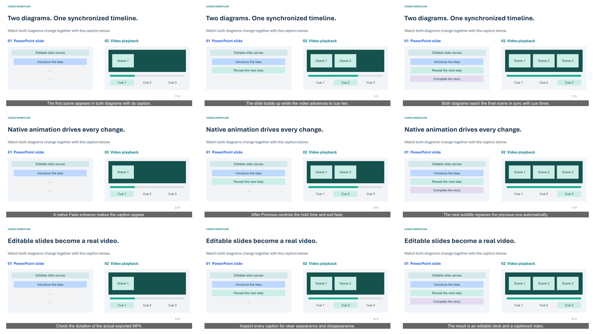

# Public demo verification

The example was generated using the demo-specific two-panel authoring script and desktop Microsoft PowerPoint on Windows.

| Check | Observed result |
|---|---|
| Slides | 3, 16:9 |
| Captions | 9 native editable text boxes |
| Fade effects | 18 native effects, entrance and exit per synchronized scene group |
| Scheduled duration | 24.0 seconds |
| Decoded MP4 duration | 24.0 seconds |
| MP4 export | PowerPoint task completed |
| Caption check | A decoded frame inside each of the 9 cue intervals was inspected |
| Diagram check | Both upper diagrams change through three states per slide, synchronized with the caption |
| Caption changes | Correct text in the sampled intervals, with no overlapping residual text |
| Preview animation | 64 decoded frames from the first 8 seconds, sampled at 8 fps |
| Original source | Retained as `subtitle-demo.pptx`; source integrity checked by the helper |



The PDF shows the first cue on each slide. The animated PPTX contains all nine captions. The GIF is an eight-second excerpt; use the MP4 and timeline CSV to inspect the complete example.

These checks establish the observed behavior of this example. They do not guarantee frame-accurate export for every Office installation, video codec or presentation. The helper's JSON report intentionally leaves actual video verification pending until decoding and inspection take place.

## Reproduce

From the repository root:

```powershell
pwsh -NoProfile -File ./examples/animate-two-panels.ps1 `
  -InputPptx ./examples/subtitle-demo.pptx `
  -TimelineCsv ./examples/timeline.csv `
  -OutputDirectory ./local-output

pwsh -NoProfile -Sta -File ./powerpoint-auto-subtitles/scripts/extract-video-frames.ps1 `
  -VideoPath ./local-output/subtitle-demo_review.mp4 `
  -TimelineCsv ./local-output/subtitle_timeline_FINAL.csv `
  -OutputDirectory ./video-check
```

Inspect the extracted images, compare their captions with the manifest, and check the decoded duration before describing the new export as verified.

